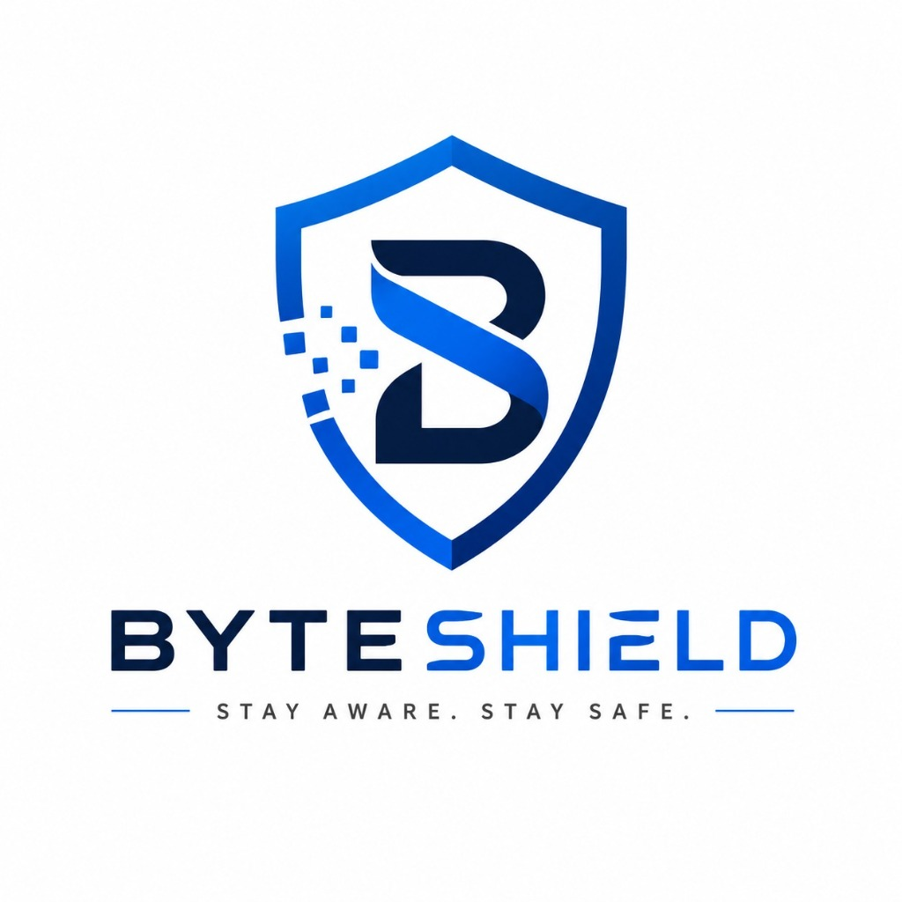

# ByteShield — AI Digital Scam Protection

<p align="center">
  
</p>

<p align="center"><strong>Your AI Shield Against Digital Scams</strong></p>

---

## 📌 What is ByteShield?

ByteShield is an AI-powered digital scam protection application designed to help users identify potentially dangerous:

- **Phishing/scam messages** (SMS, email, WhatsApp messages)
- **Suspicious URLs** (phishing links, fake websites)
- **Fake screenshots** (fake payment confirmations, fake bank messages)
- **Suspicious QR codes** (malicious URLs, fraudulent payment QRs)

The application combines **local rule-based analysis** with **Google Gemini AI** to provide comprehensive threat detection.

---

## 🔍 Problem Statement

Digital scams are a growing threat in India and worldwide. Users receive fraudulent messages, phishing links, and fake payment screenshots daily. Many people lack the technical knowledge to identify these scams.

ByteShield addresses this by providing an easy-to-use tool that analyzes suspicious content and provides clear, actionable risk assessments.

---

## ✨ Features

| Feature | Description |
|---------|-------------|
| **Message Scanner** | Analyzes text messages for scam indicators (urgency, threats, credential requests, etc.) |
| **URL Scanner** | Checks URLs for suspicious TLDs, brand impersonation, IP addresses, URL shorteners, etc. |
| **Screenshot Scanner** | Uses Gemini AI multimodal vision to analyze screenshots for scam patterns |
| **QR Code Scanner** | Decodes QR codes and analyzes embedded URLs or payment information |
| **Dashboard** | User-specific statistics showing scan counts, risk distribution, and recent activity |
| **Scan History** | Persistent record of all scans with full details |
| **User Authentication** | Secure signup/login with password hashing and session management |

---

## 🏗️ Architecture

```
┌─────────────────────────────────┐
│        Frontend (Browser)       │
│  HTML5 + CSS3 + Vanilla JS      │
│  ┌──────┐ ┌──────┐ ┌─────────┐ │
│  │Login │ │Scan  │ │Dashboard│ │
│  └──┬───┘ └──┬───┘ └────┬────┘ │
└─────┼────────┼──────────┼──────┘
      │  REST API (JSON)  │
┌─────┼────────┼──────────┼──────┐
│     ▼        ▼          ▼      │
│        Backend (Node.js)       │
│  ┌──────────────────────────┐  │
│  │     Express.js Server    │  │
│  │  ┌────────┐ ┌─────────┐ │  │
│  │  │ Auth   │ │ Scan    │ │  │
│  │  │ Routes │ │ Routes  │ │  │
│  │  └────────┘ └────┬────┘ │  │
│  │          ┌───────┼──────┤  │
│  │          ▼       ▼      ▼  │
│  │  ┌──────────┐ ┌──────┐    │
│  │  │Rule      │ │Gemini│    │
│  │  │Engine    │ │  AI  │    │
│  │  └────┬─────┘ └──┬───┘    │
│  │       ▼          ▼        │
│  │  ┌──────────────────┐     │
│  │  │   Risk Engine    │     │
│  │  │ (60% AI + 40%    │     │
│  │  │  Rule Engine)    │     │
│  │  └──────────────────┘     │
│  └──────────────────────────┘  │
│  ┌──────────────────────────┐  │
│  │    SQLite Database       │  │
│  │    (node:sqlite)         │  │
│  └──────────────────────────┘  │
└────────────────────────────────┘
```

---

## 🛠️ Technology Stack

| Layer | Technology |
|-------|-----------|
| Frontend | HTML5, CSS3, Vanilla JavaScript |
| Backend | Node.js v24, Express.js |
| Database | SQLite via `node:sqlite` (built-in) |
| AI | Google Gemini API (`@google/genai` SDK) |
| Authentication | bcryptjs (hashing), express-session |
| QR Decoding | jsQR + Jimp |
| Security | Helmet, express-rate-limit |

---

## 📦 Installation

### Prerequisites
- **Node.js v22+** (v24 recommended)
- **npm** (comes with Node.js)
- **Google Gemini API key** (optional, for AI features)

### Steps

1. **Clone or download** the project:
   ```bash
   cd ByteShield
   ```

2. **Install dependencies**:
   ```bash
   npm install
   ```

3. **Create environment file**:
   ```bash
   cp .env.example .env
   ```

4. **Edit `.env`** and add your Gemini API key:
   ```env
   GEMINI_API_KEY=your-api-key-here
   GEMINI_MODEL=gemini-3.6-flash
   PORT=3000
   SESSION_SECRET=your-secret-key
   ```

   > Get a free API key from [Google AI Studio](https://aistudio.google.com/)

5. **Start the application**:
   ```bash
   npm start
   ```

6. **Open in browser**:
   ```
   http://localhost:3000
   ```

---

## 🔑 Environment Variables

| Variable | Description | Default |
|----------|-------------|---------|
| `GEMINI_API_KEY` | Google Gemini API key | (none — AI features disabled) |
| `GEMINI_MODEL` | Gemini model to use | `gemini-3.6-flash` |
| `PORT` | Server port | `3000` |
| `SESSION_SECRET` | Secret for session encryption | (fallback provided) |

---

## 🚀 How to Run

```bash
# Production
npm start

# Development (with auto-restart)
npm run dev
```

---

## 🧠 How the AI Analysis Works

ByteShield uses **Google Gemini Flash** for intelligent analysis:

1. User submits content (message, URL, or screenshot)
2. The content is sent to Gemini AI with a structured prompt
3. Gemini analyzes the content for scam indicators
4. The AI returns a score (0-100), confidence level, indicators, and recommendation
5. The result is combined with the rule engine analysis

**Key principles:**
- AI is instructed to be **balanced and fair** — not alarmist
- Individual indicators are **risk factors**, not definitive proof
- The AI is asked to consider **context and combinations**

---

## ⚙️ How the Rule Engine Works

The rule engine provides **local, offline analysis** using pattern matching:

### Message Analysis
- **23+ regex patterns** across 7 categories
- Categories: urgency, threats, credential requests, suspicious links, financial, impersonation, social engineering
- Each pattern has a **weight** (1-15) and **severity** (low/medium/high)

### URL Analysis
- **11 checks**: protocol, TLD, IP address, URL shorteners, subdomains, brand impersonation, path keywords, obfuscation, length, encoding, hyphens
- Official domain whitelist to reduce false positives

### Dynamic Confidence
Confidence is **NOT hardcoded** — it depends on:
- Number and strength of matched indicators
- Diversity of categories
- Severity distribution
- Agreement between AI and rule engine

---

## 📊 Risk Scoring

### Thresholds
| Risk Level | Score Range |
|------------|-------------|
| **LOW** | 0–39 |
| **MEDIUM** | 40–69 |
| **HIGH** | 70–100 |

### Weighted Combination
When both AI and rule engine are available:
- **AI weight**: 60%
- **Rule engine weight**: 40%

When AI is unavailable:
- Rule engine result is used directly

### Confidence Adjustment
- AI and rules **agree** (within 15 points) → confidence boosted
- Moderate agreement (within 30 points) → standard confidence
- Significant disagreement → confidence reduced

---

## 🗄️ Database

ByteShield uses **Node.js built-in SQLite** (`node:sqlite`):

### Tables

**Users:**
| Column | Type |
|--------|------|
| id | INTEGER PRIMARY KEY |
| username | TEXT UNIQUE |
| email | TEXT UNIQUE |
| password_hash | TEXT |
| created_at | TEXT |

**Scans:**
| Column | Type |
|--------|------|
| id | INTEGER PRIMARY KEY |
| user_id | INTEGER (FK) |
| scan_type | TEXT |
| input_summary | TEXT |
| risk_level | TEXT |
| risk_score | INTEGER |
| confidence | REAL |
| reasons | TEXT (JSON) |
| recommendation | TEXT |
| analysis_source | TEXT |
| created_at | TEXT |

---

## 🔒 Security

| Measure | Implementation |
|---------|---------------|
| Password hashing | bcryptjs with 10 salt rounds |
| HTTP headers | Helmet.js |
| Rate limiting | express-rate-limit (100 req/15min general, 20/15min for auth) |
| Session security | httpOnly cookies, 24-hour expiry |
| Input validation | All endpoints validate and sanitize input |
| File upload limits | 5MB max, image types only |
| API key protection | Server-side only, never exposed to frontend |
| Data isolation | Users can only access their own data |

---

## 🧪 Testing

### Test Cases

| Test | Input | Expected |
|------|-------|----------|
| Suspicious message | "Your SBI account will be blocked..." | HIGH risk, score ~100 |
| Normal message | "Hi, your SBI account statement..." | LOW risk, score ~8 |
| Suspicious URL | `https://sbi-secure-verification.xyz/kyc-update` | MEDIUM–HIGH risk |
| Safe URL | `https://www.google.com` | LOW risk, score 0 |
| Auth protection | Access /api/scan without login | 401 Unauthorized |
| User isolation | User2 dashboard | Shows 0 scans |

---

## ⚠️ Limitations

1. **AI dependency**: Screenshot analysis requires Gemini API (no local fallback for images)
2. **Local only**: Designed for localhost deployment, not production-grade
3. **In-memory sessions**: Sessions are lost on server restart
4. **No real-time URL checking**: Does not perform DNS lookups or visit URLs
5. **Rule engine coverage**: Cannot detect all possible scam patterns
6. **Single language**: Primarily optimized for English messages
7. **No email verification**: Signup does not verify email addresses

---

## 🔮 Future Scope

1. **Browser extension** for real-time phishing protection
2. **Mobile application** (React Native / Flutter)
3. **Community-sourced scam database**
4. **Multi-language support** (Hindi, regional languages)
5. **Real-time URL reputation checking** (Google Safe Browsing API)
6. **Email integration** for automatic inbox scanning
7. **WhatsApp bot** for instant message analysis
8. **Machine learning model** trained on Indian scam datasets
9. **Admin dashboard** for analytics across all users
10. **API access** for third-party integration

---

## 🎓 Viva Questions & Answers

### Q1: What is ByteShield?
**A:** ByteShield is an AI-powered digital scam protection application that helps users identify phishing messages, suspicious URLs, fake screenshots, and suspicious QR codes using a combination of local rule-based analysis and Google Gemini AI.

### Q2: What problem does ByteShield solve?
**A:** Digital scams are increasing rapidly. Many people receive fraudulent messages and phishing links but lack the technical knowledge to identify them. ByteShield provides an easy-to-use tool that analyzes suspicious content and gives clear risk assessments with explanations.

### Q3: How does the AI analysis work?
**A:** We use Google's Gemini Flash model through their official SDK. When a user submits content, we send it to Gemini with a structured prompt asking it to analyze for scam indicators. The AI returns a risk score, confidence level, detected indicators, and a recommendation. This is combined with our local rule engine analysis.

### Q4: What happens when AI is unavailable?
**A:** The application continues working using the local rule engine. For messages and URLs, the rule engine provides complete analysis. For screenshots, a graceful fallback message is shown since image analysis requires AI.

### Q5: How does the risk scoring work?
**A:** We use a weighted combination: AI analysis contributes 60% and the rule engine contributes 40% to the final score. The score is categorized as LOW (0-39), MEDIUM (40-69), or HIGH (70-100). Confidence is dynamically calculated based on the number of indicators, their severity, and agreement between AI and rules.

### Q6: Why don't you use React or a frontend framework?
**A:** For this project, vanilla HTML/CSS/JavaScript keeps the codebase simple, easy to understand, and with no build step required. It demonstrates core web development concepts without framework overhead.

### Q7: Why use node:sqlite instead of MongoDB?
**A:** `node:sqlite` is built into Node.js v22+, requiring no external installation or native compilation. It's perfect for a local project — zero dependencies, zero configuration, and fully portable. SQLite is also ACID-compliant and fast for our use case.

### Q8: How do you ensure user data privacy?
**A:** Passwords are hashed with bcryptjs (10 salt rounds). Sessions use httpOnly cookies. Each user can only see their own data — all database queries filter by user ID. The Gemini API key stays server-side and is never exposed to the browser.

### Q9: What is the rule engine?
**A:** The rule engine is a local pattern-matching system that uses 23+ regex patterns across 7 categories (urgency, threats, credential requests, suspicious links, financial indicators, impersonation, social engineering). Each pattern has a weight and severity. The engine calculates a dynamic confidence score based on the number and diversity of matched indicators.

### Q10: How is this different from just checking a URL on VirusTotal?
**A:** ByteShield provides multi-type scanning (messages, URLs, images, QR codes) in one interface. It combines AI understanding with rule-based analysis, provides educational explanations of why something is risky (not just safe/unsafe), and maintains a personal history dashboard. It's designed for everyday users, not security professionals.

### Q11: What security measures have you implemented?
**A:** Helmet.js for secure HTTP headers, express-rate-limit to prevent brute force attacks, bcryptjs for password hashing, session-based authentication with httpOnly cookies, input validation on all endpoints, file upload restrictions (5MB, image types only), and complete data isolation between users.

### Q12: What is the business model potential?
**A:** ByteShield could be monetized as a freemium SaaS product, a browser extension with premium features, a B2B API for businesses to integrate scam detection, or a white-label solution for banks and financial institutions. The growing digital payment ecosystem in India makes this highly relevant.

---

## 📁 Project Structure

```
Byteshield/
├── backend/
│   ├── server.js              # Express application
│   ├── database.js            # SQLite database setup
│   ├── middleware/
│   │   └── auth.js            # Authentication middleware
│   ├── routes/
│   │   ├── auth.js            # Login/signup/logout
│   │   ├── scan.js            # All scan endpoints
│   │   ├── history.js         # Scan history
│   │   └── dashboard.js       # Dashboard statistics
│   ├── services/
│   │   ├── geminiService.js   # Google Gemini AI
│   │   ├── ruleEngine.js      # Local pattern analysis
│   │   ├── riskEngine.js      # Score combination
│   │   ├── urlAnalyzer.js     # URL indicator detection
│   │   └── qrDecoder.js       # QR code decoding
│   └── uploads/               # Temporary file uploads
├── frontend/
│   ├── index.html             # Main page (auth + scanner)
│   ├── dashboard.html         # Dashboard page
│   ├── css/style.css          # Stylesheet
│   ├── js/
│   │   ├── auth.js            # Authentication
│   │   ├── app.js             # App controller
│   │   ├── scanner.js         # Scanner UI
│   │   └── history.js         # Dashboard/history UI
│   └── assets/logo.jpg        # ByteShield logo
├── .env.example
├── .gitignore
├── package.json
└── README.md
```

---

<p align="center">
  <strong>ByteShield © 2026 — Stay Aware. Stay Safe.</strong>
</p>
